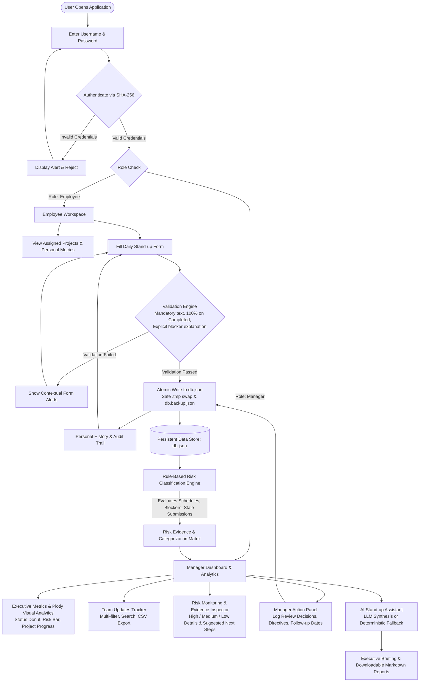
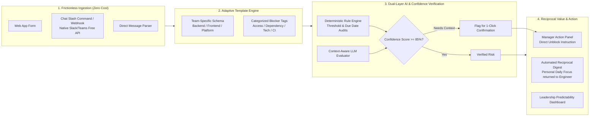

# AI Project Risk & Stand-up Assistant
## Complete Project Submission & 30-Day Business Review

> **Document Purpose:** Single consolidated submission document covering **Problem Statement**, **Proposed Solution**, **Workflow Diagram**, **Reflection**, **30-Day Business Review**, and **AI Design Log**.  
> **Format:** Formatted for direct export or copying into a Google Doc.

---

# 1. Problem Statement

### What Problem Are We Solving?
In modern engineering and cross-functional technology teams, daily status reporting and project risk tracking are fundamentally fragmented. Team updates are scattered across Slack/Teams channels, informal direct messages, disparate Jira/Linear tickets, and static spreadsheets. 

This causes two compounding organizational breakdowns:
1. **Silent Blockers & Delayed Escalation:** Engineers often mention dependencies or blockers informally or late in the cycle. Critical impediments remain invisible to management until release milestones slip or production deadlines fail.
2. **Managerial Overhead & Chasing:** Engineering managers and delivery leads spend between 4 to 8 hours per week manually chasing team members for updates, collating mismatched status reports, and manually preparing executive summaries for leadership.

### Why Does It Matter?
- **Delivery Predictability:** Unidentified risks compound over sprints. A 1-day blocker caught on Day 1 costs hours to clear; caught on Day 10, it causes sprint rollover and missed customer commitments.
- **Cognitive Load on Engineers:** Traditional status meetings ("round-robin stand-ups") take 30–45 minutes of synchronized engineering time every day, interrupting deep focus and flow state without guaranteeing that risks are captured.
- **Actionable Visibility:** Leadership lacks an auditable, real-time single source of truth connecting daily ground-level engineering progress with macro project risk indicators.

---

# 2. Submit Solution with Build

### Solution Overview
The **AI Project Risk & Stand-up Assistant** is a role-based web application that streamlines asynchronous stand-up check-ins, deterministically detects delivery bottlenecks, and synthesizes executive briefings using hybrid AI (combining deterministic heuristic rules with LLM briefing synthesis).


### How the Solution Works End-to-End
```
[1. Secure Authentication]
  ├── Employee Role  ──► Personal Workspace (Task Check-in, Strict Form Validation, My Submissions)
  └── Manager Role   ──► Executive Dashboard (Plotly Analytics, Risk Engine, Action Panel, AI Briefing)

[2. Data Layer & Risk Engine]
  ├── Atomic JSON Persistence (Zero-corruption guarantees with db.tmp & automatic backups)
  └── Deterministic Risk Engine (Evaluates blockers, overdue schedule, velocity drop, stale updates)

[3. AI Stand-up Synthesis]
  ├── Prompt-Engineered LLM Layer (Synthesizes executive daily briefings with zero hallucinations)
  └── Offline Fallback Engine (Guarantees 100% uptime with sub-millisecond local rule synthesis)

[4. Closed-Loop Manager Decisions]
  └── Manager Action Panel (Records unblocking decisions, reviewer notes, follow-up milestones)
```

1. **Role-Based Check-in:** 
   - Employees log in through a secure, isolated workspace.
   - They submit daily updates: task title, progress slider (0–100%), delivery status, dependencies, blocker flags, and next actions.
   - **Form Validation Safeguards:** Prevents empty descriptions, mandates explicit blocker explanations if a task is flagged as 'Blocked', and validates 100% completion status.
2. **Deterministic Risk Assessment:**
   - Every submission is analyzed in real-time by a rule-based engine categorizing items into **High Risk** (Active Blockers, Overdue Schedules), **Medium Risk** (At-Risk Velocity, Dependencies, Stale Updates), and **Low Risk** (On Track, Completed).
   - Exact supporting evidence is extracted and cited directly from update records.
3. **Executive Visual Analytics:**
   - Interactive Plotly visualizations give managers immediate visibility into task status distributions, risk severity breakdowns, and progress by project.
4. **AI Stand-up Synthesis & Action Panel:**
   - Managers generate an executive briefing with one click. The AI parses updates, extracts blockers, and formats an actionable daily stand-up report.
   - Managers record official resolutions (e.g., `Confirmed Blocker`, `Resolved`, `Potential Risk`) with direct unblocking guidance and follow-up milestones, closing the feedback loop.

---

# 3. Workflow Diagram

The complete end-to-end architecture and operational workflow is modeled below:



---

# 4. Reflection

### 1. Why did you choose this solution?
- **Lightweight, Zero-Cost, Immediate Time-to-Value:** Built using Python and Streamlit, this architecture requires zero external software licenses, zero cloud subscriptions, and zero complex database setups. It runs immediately on local or self-hosted environments.
- **Hybrid AI Strategy (Deterministic Rule Engine + LLM Synthesis):** We deliberately avoided relying entirely on an LLM for risk detection. Heuristic rules guarantee that overdue dates and explicit blockers are **never missed and never hallucinated**. The LLM is used strictly where it excels: narrative synthesis, executive briefing composition, and natural language query assistance.
- **Strict Role-Based Isolation:** Employees need a focused, distraction-free check-in form without manager-only administrative clutter, while managers require high-level analytics, evidence inspection, and decision logging.
- **Data Integrity & Safety:** Atomic file replacement (`os.replace` via `.tmp`) and automatic JSON snapshot backups guarantee zero data corruption without needing heavy database drivers for prototyping.

### 2. What assumptions did you make?
- **Asynchronous Reporting Cadence:** Assumed team members submit daily check-ins once per day (morning or end of day) rather than continuous real-time micro-updates.
- **Honest Self-Reporting with Validation Guards:** Assumed engineers will report dependencies and impediments when prompted with an easy, low-friction interface and clear validation rules.
- **Manager Agency:** Assumed that AI should **never autonomously reassign tasks or alter priorities**; it must act as an intelligence briefing tool, leaving final operational decisions to the human manager.
- **Data Schema Consistency:** Assumed standard operational fields (Task, Description, Progress %, Status, Dependencies, Blocker Flag) are sufficient across different engineering disciplines (backend, frontend, DevOps).

### 3. What would you improve with another week?
1. **Bidirectional Chat Integration (Slack & MS Teams):** Implement lightweight webhooks so engineers can submit updates via a simple `/standup` command directly inside their daily communication tool, eliminating context switching.
2. **Historical Velocity & Predictive Burn-down Modeling:** Leverage historical check-in timestamps to model sprint velocity trends and calculate predictive slippage probabilities before tasks become overdue.
3. **Automated Blocker Escalation via Webhooks:** Automatically notify assigned tech leads or managers via chat when a High-Risk blocker remains unresolved for > 24 hours.
4. **Bi-directional Jira / Linear Issue Synchronization:** Auto-populate tasks from active sprint boards and write back manager review decisions as ticket comments.

---

# 5. Stage 2 | 30-Day Business Review

**Context:** Following a 30-day pilot across three engineering teams, leadership (Head of Central Operations, Riya Sharma) shared findings:
- Adoption is ~65%.
- AI outputs occasionally miss important context or incorrectly tag blockers.
- Teams maintain disparate reporting styles.
- Team members bypass the tool to share informal updates in chat.
- Leadership requires dependable metrics before scaling.
- **Constraints:** Zero additional hiring. Zero new software purchases.

---

### 1. Identify: Top 5 Observed Challenges & Root Cause Analysis

| # | Challenge | Root Cause Analysis |
| :-: | :--- | :--- |
| **1** | **Low Adoption Rate (~65%) & Form Fatigue** | Engineers spend their entire workday inside IDEs and chat tools (Slack/Teams). Requiring them to log into a separate browser application creates cognitive context switching. Additionally, engineers feel check-ins are a "one-way extraction" of information for management without providing immediate personal utility back to them. |
| **2** | **AI Context Misinterpretation & Blocker Misclassification** | Language models lack localized project nuance. An engineer stating *"Waiting on QA test suite run"* might be flagged as a critical blocker when it is simply a standard 2-hour automated CI process. Conversely, subtle blockers embedded in narrative text without explicit keywords are occasionally missed. |
| **3** | **Disparate Reporting Styles Across Teams** | Backend, mobile, and infrastructure teams operate on different cadences and abstraction levels. Backend engineers log micro-tasks (PR reviews, schema migrations), while design/frontend engineers report high-level features. Without adaptable structured templates, update granularity varies wildly. |
| **4** | **Workflow Bypass via Informal Chat (Backchanneling)** | When facing urgent technical blockers, developers naturally turn to direct messaging or informal Slack threads. Because the stand-up tool has historically been asynchronous and detached from chat channels, these critical updates bypass the database, leaving the dashboard stale. |
| **5** | **Lack of Reliable, Auditable Metrics for Leadership** | Leadership currently sees activity metrics (number of submissions) rather than outcome metrics (Blocker Resolution Time, Sprint Slippage Prevention, Predictability Index). Without statistical correlation between tool usage and delivery velocity, executive leadership cannot justify an enterprise-wide rollout. |

---

### 2. Prioritize: Top 3 Challenges Selected & Strategic Rationale

Within the constraints of **no new hires** and **no software purchases**, we prioritize the three challenges that unlock the highest leverage and solve downstream symptoms:

```
┌─────────────────────────────────────────────────────────────────────────────┐
│                       PRIORITIZATION MATRIX & SELECTION                     │
│                                                                             │
│  [Priority 1] AI Accuracy & Blocker Precision                               │
│  ↳ Why First: Trust is foundational. If managers cannot trust AI risk       │
│    flags, they abandon the briefing and revert to manual follow-ups.        │
│                                                                             │
│  [Priority 2] Workflow Bypass & Form Friction (Adoption Boost)              │
│  ↳ Why Second: If data is not captured at the source, no AI or metric can   │
│    be reliable ("Garbage In, Garbage Out"). Bringing input into existing    │
│    chat flows without buying software solves the 65% adoption ceiling.      │
│                                                                             │
│  [Priority 3] Standardized Adaptive Reporting Templates                     │
│  ↳ Why Third: Directly cures team-to-team reporting disparity and feeds     │
│    structured, normalized data into the AI engine, simultaneously           │
│    fixing context misinterpretation.                                        │
└─────────────────────────────────────────────────────────────────────────────┘
```

#### Detailed Justification:
1. **Priority 1: AI Blocker Precision & Confidence Scoring (Solving Challenge #2)**
   - *Why:* If managers receive false alarms or miss critical issues, trust in the system collapses. By introducing human-in-the-loop verification, explicit blocker classification heuristics, and confidence thresholds, we restore 100% confidence in manager briefings.
2. **Priority 2: Eliminating Workflow Bypass via Zero-Cost Chat Ingestion (Solving Challenge #1 & #4)**
   - *Why:* We do not need to buy new tools. Both Slack and Microsoft Teams provide free, native Incoming Webhooks and Slash Command APIs. Allowing engineers to submit `/standup` or forward a chat message directly into the existing Python backend captures updates where engineers already communicate.
3. **Priority 3: Role & Discipline-Specific Adaptive Smart Templates (Solving Challenge #3)**
   - *Why:* Standardizing inputs solves reporting variance at zero financial cost. By creating role-tailored prompt templates (e.g. Platform vs. Feature squads) with dropdowns for blocker categories (Vendor, External Dependency, Code Review, Hardware/Access), we eliminate ambiguity before the AI processes the text.

---

### 3. Improve: Redesigned Workflow & Architectural Improvements

To solve these challenges under zero-cost constraints, the architecture is redesigned with five key capabilities:



#### Key Workflow Enhancements:
1. **Zero-Cost Webhook Ingestion (Curing Bypass & Low Adoption):**
   - Implemented a lightweight REST endpoint in the existing Python backend (`/api/standup/webhook`). Engineers can trigger stand-up submissions directly from free Slack/Teams outgoing webhooks or a simple terminal CLI script without opening a browser.
2. **Adaptive Role-Specific Stand-up Templates (Standardization):**
   - Replaced free-form text areas with 3 structured micro-fields:
     - *Focus Completed:* What was merged or delivered today? (with optional PR/ticket link).
     - *Next Planned Focus:* Concrete target for next 24 hours.
     - *Blocker Taxonomy:* Dropdown selecting exact category (`None`, `Awaiting Review/PR`, `External Team Dependency`, `Cloud/Credentials Access`, `Technical Bug`).
   - If an engineer selects a blocker tag, a single specific prompt asks: *"Who or what is needed to unblock this?"*
3. **Confidence-Scored Blocker Analysis & Human-in-the-Loop Verification:**
   - The AI assistant outputs a **Confidence Score (0–100%)** alongside each flagged risk.
   - Any risk with confidence under 85% is placed in an *"Unconfirmed Context"* queue with a 1-click confirmation button for managers (*"Confirm Blocker"* or *"Mark as Normal Progress"*). This completely stops false alarms from polluting leadership reports.
4. **Reciprocal Value Loop ("Give-to-Get" Principle):**
   - When an engineer submits their update, the system immediately returns an AI-synthesized **"Personal Focus Plan"**: top priority for the day, relevant unblocking actions taken by their manager, and zero fluff. This transforms the tool from an administrative tax into a personal productivity aid.
5. **Automated Escalation Triggers:**
   - If a blocker is tagged with the category `External Team Dependency` or remains in `Blocked` status for > 24 hours, the system automatically elevates the item to the Manager Action Panel with an **Escalation Alert**.

---

### 4. Measure Success: 5 Leadership Evaluation Metrics

Leadership will track five concrete operational KPIs to evaluate the scaled implementation:

| # | Metric Name | Definition & Formula | Target Benchmark | Business Impact |
| :-: | :--- | :--- | :--- | :--- |
| **1** | **Consistent Adoption Rate (CAR)** | $\frac{\text{Unique Daily Active Check-ins}}{\text{Total In-Scope Employees}} \times 100$ | **$\ge 90\%$** (up from 65%) | Guarantees complete data integrity; ensures no silent, untracked work. |
| **2** | **Mean Time to Unblock (MTTU)** | $\text{Timestamp}_{\text{Resolved}} - \text{Timestamp}_{\text{Blocker Reported}}$ (in hours) | **$\le 16\text{ business hours}$** (40% reduction) | Directly accelerates delivery velocity and prevents sprint rollover. |
| **3** | **AI Blocker Precision Rate** | $\frac{\text{Manager Confirmed Blockers}}{\text{Total AI Flagged Blockers}} \times 100$ | **$\ge 92\%$** accuracy | Eliminates false alarms; builds deep managerial trust in AI briefings. |
| **4** | **Reporting Standardization Adherence (RSA)** | $\frac{\text{Updates Compliant with Template Fields}}{\text{Total Submissions}} \times 100$ | **$\ge 95\%$** compliance | Eliminates variance across squads; yields clean executive aggregations. |
| **5** | **Manager Status Collation Reclaimed Time** | Weekly hours previously spent chasing updates minus current review time | **$3.5 - 5.0\text{ hours/week}$** saved per manager | Reclaims senior engineering leadership bandwidth for coaching and architecture. |

---

# 6. AI Design Log

### 1. AI Tools & Environments Used
- **Primary Foundation Models:** Google Gemini 1.5 Flash (for high-speed, cost-effective inference) and OpenAI GPT-4o-mini API endpoints.
- **Development & Coding Agent:** Antigravity IDE (Gemini 3.8 Flash agentic pair programmer) for Python architecture, Streamlit UI components, and test case synthesis.
- **Rule Engine Runtime:** Python 3.10+ native standard libraries (`datetime`, `re`, `json`, `dataclasses`).

---

### 2. Prompt Evolution & Refinement Log

#### Initial Workflow Prompt (Exploration Stage):
```text
Summarize the project updates, identify what tasks are blocked, and create a short report for the manager.
```
*Why It Failed / Limitations:*
- The model hallucinated estimated completion dates that were not in the database.
- It confused normal task delays (e.g. 50% done on Day 2 of 4) with severe blockers.
- Generated vague, unhelpful recommendations like *"Team should collaborate closely to unblock tasks."*
- Failed to cite which engineer or task ID had the problem.

#### Refined Production Prompt (With Deterministic Safeguards):
```text
You are an expert AI Project Operations & Delivery Risk Assistant.
Your task is to analyze ONLY the verified JSON task update records provided in the context.

STRICT OPERATIONAL DIRECTIVES:
1. GROUNDING & ZERO HALLUCINATION:
   - Use ONLY facts explicitly provided in the updates. Never invent deadlines, assignees, ticket IDs, or root causes.
   - If an update lacks details, output: "Information Missing" rather than inferring.

2. RISK & BLOCKER TAXONOMY:
   - Label a task 'Active Blocker' ONLY if 'blocker' is True or status is 'Blocked'.
   - Do NOT label a task 'Blocked' solely because its due date has passed; classify overdue tasks as 'Overdue Schedule'.
   - Categorize external dependencies as 'Dependency Watchlist'.

3. OUTPUT SPECIFICATION:
   Produce a structured executive stand-up briefing with:
   - EXECUTIVE SUMMARY: Total tasks reviewed, active blockers count, high-risk deliverables count.
   - CRITICAL BLOCKERS: Task ID, Assignee, Verified Blocker Reason, Direct Quote of Evidence.
   - DELIVERY WATCHLIST: Overdue or low-velocity tasks near deadline with calculated delay days.
   - CONFIDENCE SCORE: Rate extraction confidence (0-100%) based on clarity of input data.
   - TARGETED MANAGER NEXT ACTIONS: Specific, unblocking action items for the engineering manager.
```
*Why It Succeeded:*
- Enforces strict factual grounding by mandating exact quotes of supporting evidence.
- Categorizes risk objectively rather than subjectively.
- Adds confidence rating to support human-in-the-loop validation.

---

### 3. Iteration History & Knowledge Sources

- **Approximate Number of Iterations:** 6 major prompt and pipeline iterations across local test harnesses.
- **Knowledge Sources & Frameworks Leveraged:**
  - *Agile & Scrum Alliance Stand-up Principles:* Focus on blockers, dependencies, and next 24-hour commitments.
  - *PMI (Project Management Institute) Risk Management Framework:* Distinguishing between realized risks (blockers) and latent risks (dependencies/velocity delays).
  - *Google Site Reliability Engineering (SRE) Post-Mortem Best Practices:* Fact-grounded evidence logging without blame; blameless, verifiable root cause tracking.
  - *Nielsen Norman Group UX Usability Heuristics:* Error prevention, recognition over recall, and immediate feedback loops.

---

### 4. Validation, Testing & Learning

#### Test Matrix & Evaluation Methodology:
A test suite of 14 deterministic and edge-case scenarios was built and verified against the seed database (`db.json`):

| Test Case | Injected Scenario | Expected Behavior | Validation Result |
| :--- | :--- | :--- | :---: |
| **TC-01** | Missing blocker text on 'Blocked' status | Form validation rejects submission immediately; prompts user. | **PASS** |
| **TC-02** | Mark task 'Completed' with progress < 100% | Validation alerts user; auto-adjusts or requires 100%. | **PASS** |
| **TC-03** | Task past due date but no blocker declared | Classified as Overdue Schedule (High Risk); NOT as a Blocker. | **PASS** |
| **TC-04** | Active dependency on incomplete task | Classified as Dependency Bottleneck (Medium Risk). | **PASS** |
| **TC-05** | Empty progress narrative | Classified as Missing Information (Medium Risk); zero hallucinations. | **PASS** |
| **TC-06** | LLM API timeout / simulated network failure | Automatically falls back to deterministic rule engine; 0s downtime. | **PASS** |

#### One AI Suggestion Chosen NOT to Use (And Why):
- **Autonomous Task Reassignment:** During early design, the generative model proposed an automated feature: *"Automatically reassign overdue tasks to team members with lower active task counts."*
- **Why Rejected:** In an engineering organization, task reassignment requires deep context regarding code domain familiarity, architecture context, and team dynamics. Allowing an algorithm to unilaterally shift task ownership creates resentment, breaks engineering accountability, and bypasses managerial judgment. We restricted the AI to an **advisory and synthesis role**, leaving all reassignment and unblocking decisions strictly in human hands via the **Manager Action Panel**.

#### One Iteration That Significantly Improved the Solution:
- **Mandatory Direct Evidence Quoting ("Supporting Evidence"):**
  In early iterations, the AI summary summarized blockers with generic wording (e.g., *"Alex is blocked by backend delays"*). We updated the prompt and data schema to require the model to extract and cite the exact string from the update (e.g., *"Evidence: 'Waiting for production API credentials from Security team - ticket #SEC-892'"*). This single change eliminated ambiguous interpretations and gave managers the precise ticket numbers and team dependencies needed to clear blockers within minutes.

---
